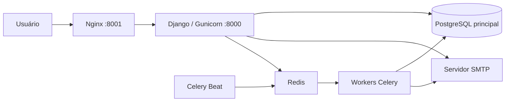

# Visão geral da arquitetura

## Objetivo

<!-- PREENCHER: o que o sistema faz, para quem e quais processos automatiza. -->

Projeto Django dividido em apps de domínio, PostgreSQL, tarefas assíncronas em Celery, front-end com Tailwind CSS + DaisyUI e execução via Docker Compose — arquitetura comum a todos os sistemas derivados do projeto base.

## Componentes



No compose completo, o Nginx (`frontend-proxy`) publica a aplicação em `http://localhost:8001` (`APP_PORT`), encaminha as requisições para o Gunicorn na porta `8000` e serve os arquivos estáticos coletados no volume `static_files`. No compose de desenvolvimento, o navegador acessa diretamente o `runserver` do Django, exposto na mesma porta externa.

## Aplicações Django

Registradas em `src/config/settings.py` (`INSTALLED_APPS`), todas em `src/apps/` e importadas como `apps.<nome>` (o label Django continua o nome simples, ex. `core`):

| Aplicação | Responsabilidade |
| --- | --- |
| `core` | usuário customizado (`core.Usuario`), setores, cargos, login/logout, home e a política de acesso (papel de gestor via `Setor.gestor_sistema`, decorator `gestor_requerido`, processadores de contexto) |
| `theme` | compilação do Tailwind CSS e DaisyUI via `django-tailwind` |
| `django_celery_beat` | biblioteca: agendamentos persistidos no PostgreSQL |

<!-- PREENCHER: apps de domínio do projeto. -->

## Fluxo de uma requisição autenticada

1. O middleware do Django recupera o usuário da sessão.
2. O processador de contexto `apps.core.processadores_contexto.contexto_permissoes` calcula se o usuário é gestor (`usuario_e_gestor`), a partir dos cargos ativos em setores com `gestor_sistema=True` (ou `is_superuser`).
3. A navegação mostra os itens de gestão somente quando `usuario_e_gestor` é `True` — é conveniência de interface, não barreira de segurança.
4. A view de destino executa `@gestor_requerido` (áreas de gestão) ou `@login_required` (áreas do usuário comum), independentemente da visibilidade do link.
5. A view consulta o PostgreSQL por meio de `selectors/` e delega escrita/regra de negócio a `services/`.
6. O template estende o layout compartilhado `src/templates/base.html` (CSS gerado pelo app `theme`).

## Estrutura do repositório

```text
projeto/                              # raiz do repositório (PROJECT_ROOT)
├── src/                              # código Django (BASE_DIR); diretório de trabalho nos containers
│   ├── manage.py
│   ├── config/                       # settings, urls, wsgi, asgi e celery.py
│   ├── apps/                         # apps Django, importados como apps.<nome>
│   │   ├── core/                     # usuário, setores, cargos, login e política de acesso
│   │   │   ├── admin/                # UsuarioAdmin, SetorAdmin, CargoAdmin
│   │   │   ├── models/               # Usuario, Setor, Cargo (um arquivo por model)
│   │   │   ├── selectors/            # permissoes.py (usuario_e_gestor), setores.py
│   │   │   ├── services/             # escrita (vazio no base)
│   │   │   ├── views/                # auth.py (login/logout) e home.py
│   │   │   ├── utils/                # formularios.py (erros_por_campo)
│   │   │   ├── decorators.py         # gestor_requerido
│   │   │   ├── processadores_contexto.py
│   │   │   ├── tasks.py              # tarefa-modelo do Celery
│   │   │   └── migrations/
│   │   └── theme/                    # app django-tailwind (static_src/ com o tema DaisyUI)
│   ├── templates/                    # base.html, 403.html, partials/ e uma pasta por app
│   ├── tests/                        # testes por app
│   └── static/                       # arquivos estáticos de origem
├── scripts/utils/                    # utilitários de desenvolvimento
├── docs/                             # esta documentação
├── pyproject.toml                    # manifesto e dependências diretas do Poetry
├── poetry.lock                       # versões reproduzíveis das dependências
├── docker-compose.yml                # ambiente completo (Gunicorn + Nginx + Celery)
├── docker-compose.dev.yml            # ambiente de desenvolvimento (autoreload + Tailwind watch)
├── Dockerfile                        # imagem Python e build do frontend
└── nginx.conf                        # proxy reverso e arquivos estáticos
```

Organização de cada app de domínio: pacotes `models/`, `views/` e `admin/` com `__init__.py` reexportando os símbolos públicos, `urls.py` com rotas nomeadas, escrita isolada em `services/` e leitura composta isolada em `selectors/`. As views são funções (sem Class-Based Views), usam `@gestor_requerido`/`@login_required`, `messages`, `get_object_or_404` e `@require_POST` para mutações. O projeto **não usa `forms.py`/Django Forms**. Ver [Camadas de código](camadas-e-padroes-de-codigo.md).

## Tecnologias principais

- Python 3.14 nas imagens Docker (`pyproject.toml` exige `>=3.13`).
- Poetry 2.4 no estágio de build; virtualenv de execução em `/opt/venv`.
- Django 5.2.
- PostgreSQL 17 no compose.
- Celery 5.6, Redis 7, `django-celery-beat` 2.9 e Flower 2.1.
- Gunicorn e Nginx no ambiente completo.
- Tailwind CSS 4 e DaisyUI 5 via `django-tailwind` 4.5.
- Node.js 22 para o build do frontend.

## Configuração relevante do Django

- `LANGUAGE_CODE = "pt-br"`, `TIME_ZONE = "America/Sao_Paulo"`, `USE_TZ = True`.
- `APP_NOME` (variável de ambiente) — nome exibido nos templates (`{{ app_nome }}`).
- `AUTHENTICATION_BACKENDS`: `django.contrib.auth.backends.ModelBackend`.
- `CELERY_BEAT_SCHEDULER = "django_celery_beat.schedulers:DatabaseScheduler"`.
- `TAILWIND_APP_NAME = "theme"`.
- `BASE_DIR` aponta para `src/` e `PROJECT_ROOT` para a raiz do repositório, de onde vêm `.env`, `staticfiles/` e `media/`.
- `AUTH_USER_MODEL = "core.Usuario"`.
- `TEMPLATES["DIRS"] = [BASE_DIR / "templates"]`.
- `STATIC_ROOT = PROJECT_ROOT / "staticfiles"`, servido pelo Nginx no compose completo.
- `EMAIL_BACKEND` SMTP com `EMAIL_USE_TLS = True`.
